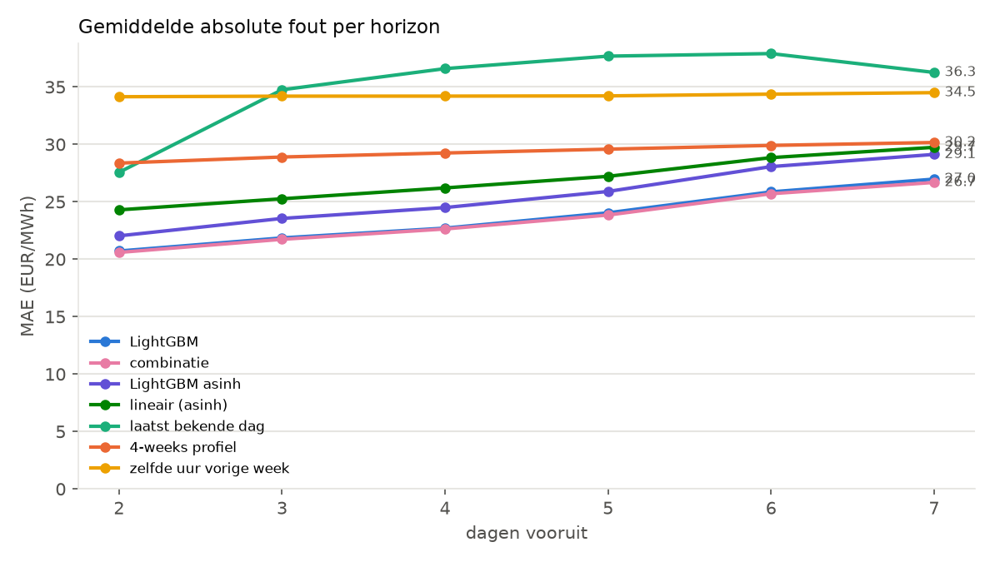
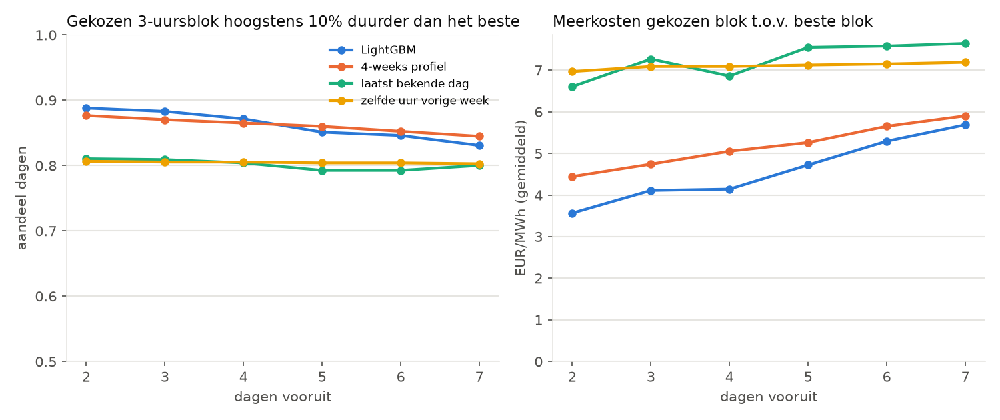
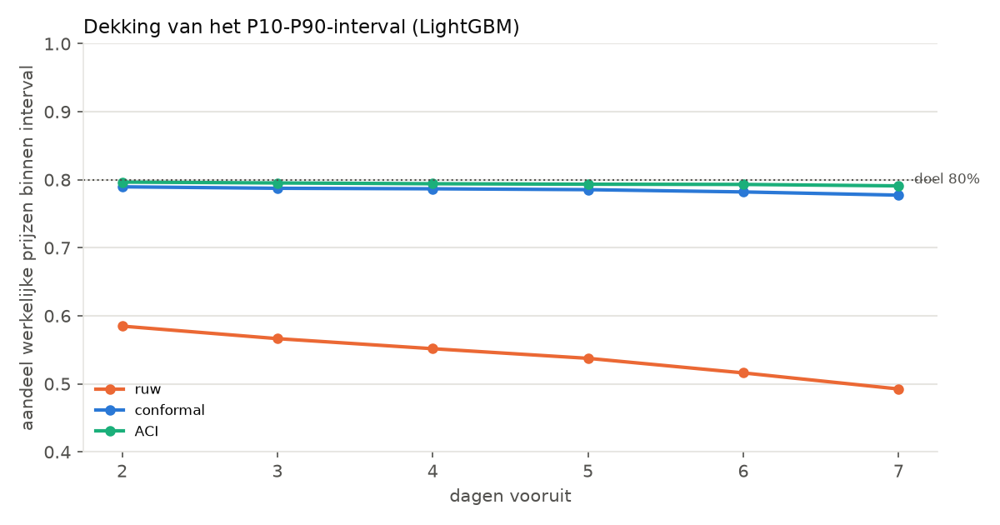
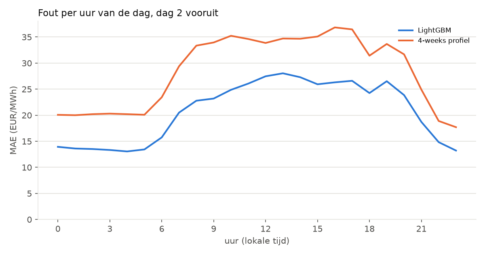
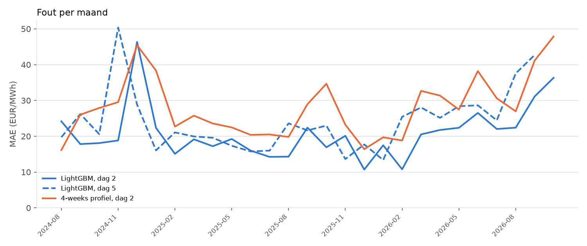
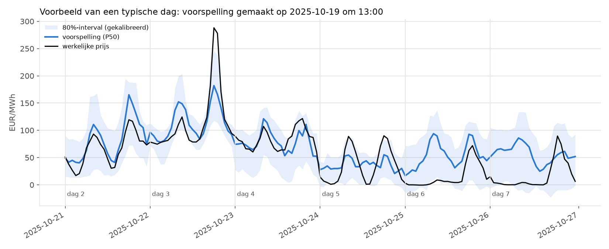
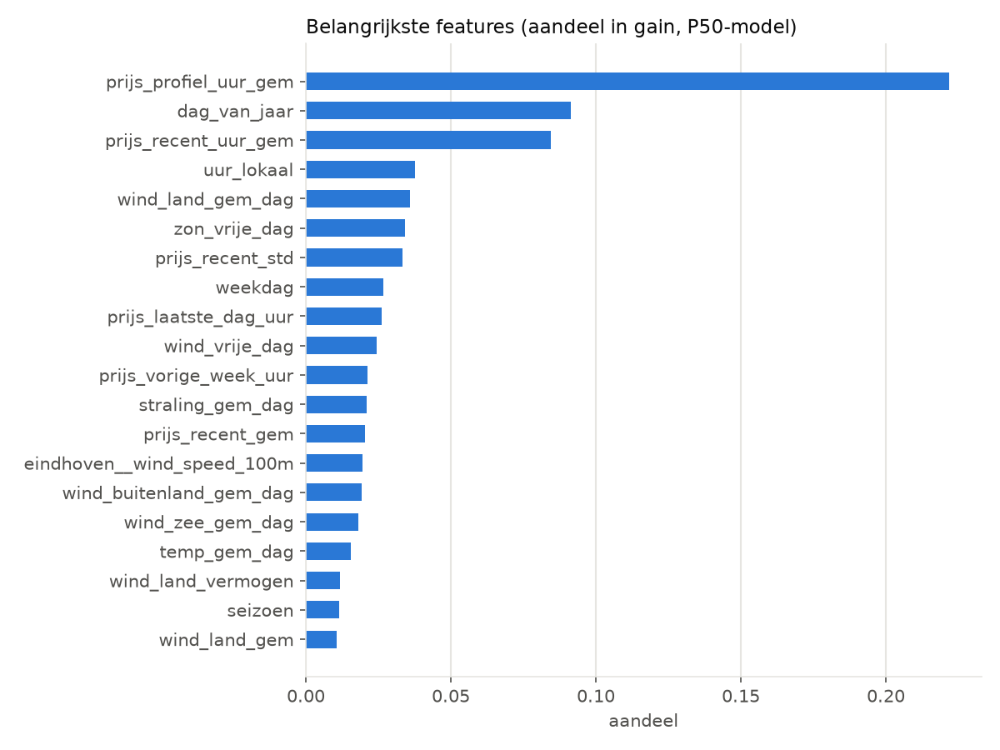
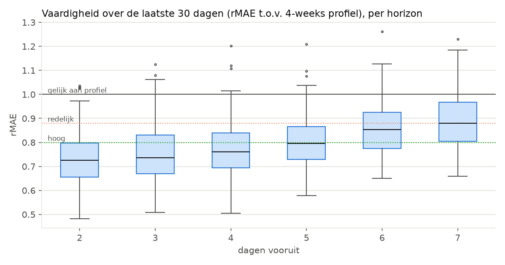

# Backtest stroomprijsvoorspeller

Gegenereerd door `epv backtest`. Voorspelmomenten: 2024-08-29 t/m 2026-10-23 (786 dagen), elke dag om 13:00 lokaal, waarop de day-ahead prijzen tot en met morgen bekend zijn. Voorspeld: dag 2 t/m 7 vooruit, alle uren. Trainingsvenster 365 dagen, hertrainen elke 7 dagen, conformal-kalibratie op 30 dagen bekende uitkomsten. Fouten in EUR/MWh (10 EUR/MWh = 1 ct/kWh).

## Samenvatting

- Het model (LightGBM-kwantiel) zit op dag 2 gemiddeld 20.7 EUR/MWh naast de werkelijke uurprijs en op dag 7 27.0. Het beste naïeve ijkpunt, het 4-weeks uurprofiel, zit op 28.4 tot 30.2. Relatief: 0.73 op dag 2 tot 0.89 op dag 7 (1,00 = even goed als het profiel).
- Het verschil met het profiel is op elke horizon statistisch significant (Diebold-Mariano, eenzijdig, HAC): p < 0.0001 op alle horizonten.
- Het 80%-interval dekt na conformal-correctie 78 tot 79% van de werkelijke prijzen (zonder correctie 49 tot 58%). Met online bijsturing (ACI) 79 tot 80%.
- Praktijkmaat: op dag 2 kiest het model op 89% van de dagen een 3-uursblok dat hoogstens 10% duurder is dan het echte goedkoopste blok (profiel: 88%); op dag 7 is dat 83% (profiel 84%). De gemiddelde meerkosten van het gekozen blok zijn 3.6 EUR/MWh op dag 2 en 5.7 op dag 7, tegen 4.4 en 5.9 voor het profiel.
- **Eerlijke kanttekening:** voor het kiezen van het goedkoopste blok is de winst van het model klein. Het goedkoopste blok ligt structureel in de nacht (winter) of de middag (zomer), en dat weet een 4-weeks profiel ook. Het model wint vooral op het prijsniveau en op dagen waarop het weer het patroon doorbreekt.

## 1. Fout per horizon

### Dag 2 vooruit

| methode | MAE | RMSE | rMAE | pinball P10 | pinball P50 | pinball P90 | dekking ruw | dekking kal. | breedte kal. |
|---|---|---|---|---|---|---|---|---|---|
| combinatie | 20.59 | 33.16 | 0.726 | 9.54 | 10.29 | 5.00 | 0.746 | 0.794 | 111.7 |
| LightGBM | 20.71 | 34.94 | 0.730 | 4.98 | 10.36 | 5.33 | 0.585 | 0.790 | 62.8 |
| LightGBM asinh | 22.03 | 36.50 | 0.777 | 4.78 | 11.02 | 5.52 | 0.617 | 0.792 | 62.8 |
| lineair (asinh) | 24.30 | 37.18 | 0.856 | 15.52 | 12.15 | 5.51 | 0.771 | 0.797 | 172.9 |
| laatst bekende dag | 27.56 | 44.10 | 0.972 | 7.84 | 13.78 | 8.09 |  | 0.789 | 88.3 |
| 4-weeks profiel | 28.37 | 42.80 | 1.000 | 7.37 | 14.18 | 7.15 |  | 0.790 | 84.9 |
| zelfde uur vorige week | 34.14 | 54.44 | 1.204 | 9.53 | 17.07 | 9.42 |  | 0.788 | 109.2 |

### Dag 3 vooruit

| methode | MAE | RMSE | rMAE | pinball P10 | pinball P50 | pinball P90 | dekking ruw | dekking kal. | breedte kal. |
|---|---|---|---|---|---|---|---|---|---|
| combinatie | 21.73 | 34.94 | 0.752 | 9.33 | 10.87 | 5.31 | 0.724 | 0.792 | 109.5 |
| LightGBM | 21.85 | 36.19 | 0.756 | 5.39 | 10.93 | 5.58 | 0.566 | 0.787 | 66.4 |
| LightGBM asinh | 23.55 | 37.92 | 0.815 | 5.25 | 11.77 | 5.80 | 0.593 | 0.793 | 67.2 |
| lineair (asinh) | 25.26 | 39.05 | 0.874 | 14.67 | 12.63 | 5.85 | 0.758 | 0.792 | 164.4 |
| 4-weeks profiel | 28.90 | 43.53 | 1.000 | 7.53 | 14.45 | 7.36 |  | 0.788 | 86.4 |
| zelfde uur vorige week | 34.19 | 54.51 | 1.183 | 9.58 | 17.10 | 9.54 |  | 0.786 | 109.3 |
| laatst bekende dag | 34.75 | 54.56 | 1.203 | 9.66 | 17.38 | 9.81 |  | 0.789 | 115.5 |

### Dag 4 vooruit

| methode | MAE | RMSE | rMAE | pinball P10 | pinball P50 | pinball P90 | dekking ruw | dekking kal. | breedte kal. |
|---|---|---|---|---|---|---|---|---|---|
| combinatie | 22.63 | 36.14 | 0.774 | 11.24 | 11.32 | 5.58 | 0.698 | 0.791 | 129.3 |
| LightGBM | 22.71 | 37.20 | 0.776 | 5.64 | 11.35 | 5.84 | 0.552 | 0.787 | 69.5 |
| LightGBM asinh | 24.50 | 39.02 | 0.838 | 5.39 | 12.25 | 6.05 | 0.582 | 0.790 | 69.1 |
| lineair (asinh) | 26.21 | 40.12 | 0.896 | 18.23 | 13.10 | 6.11 | 0.738 | 0.795 | 200.6 |
| 4-weeks profiel | 29.25 | 43.94 | 1.000 | 7.59 | 14.62 | 7.50 |  | 0.789 | 87.7 |
| zelfde uur vorige week | 34.20 | 54.51 | 1.169 | 9.63 | 17.10 | 9.54 |  | 0.783 | 109.0 |
| laatst bekende dag | 36.59 | 57.66 | 1.251 | 10.40 | 18.30 | 10.10 |  | 0.790 | 119.8 |

### Dag 5 vooruit

| methode | MAE | RMSE | rMAE | pinball P10 | pinball P50 | pinball P90 | dekking ruw | dekking kal. | breedte kal. |
|---|---|---|---|---|---|---|---|---|---|
| combinatie | 23.85 | 37.42 | 0.806 | 13.48 | 11.92 | 5.84 | 0.674 | 0.790 | 152.4 |
| LightGBM | 24.04 | 38.79 | 0.813 | 5.94 | 12.02 | 6.21 | 0.538 | 0.785 | 72.5 |
| LightGBM asinh | 25.90 | 40.48 | 0.876 | 5.74 | 12.95 | 6.38 | 0.571 | 0.791 | 72.3 |
| lineair (asinh) | 27.22 | 41.06 | 0.920 | 22.40 | 13.61 | 6.33 | 0.720 | 0.791 | 243.1 |
| 4-weeks profiel | 29.58 | 44.32 | 1.000 | 7.68 | 14.79 | 7.56 |  | 0.785 | 88.3 |
| zelfde uur vorige week | 34.22 | 54.52 | 1.157 | 9.66 | 17.11 | 9.51 |  | 0.782 | 108.9 |
| laatst bekende dag | 37.68 | 59.21 | 1.274 | 10.65 | 18.84 | 10.28 |  | 0.786 | 121.8 |

### Dag 6 vooruit

| methode | MAE | RMSE | rMAE | pinball P10 | pinball P50 | pinball P90 | dekking ruw | dekking kal. | breedte kal. |
|---|---|---|---|---|---|---|---|---|---|
| combinatie | 25.70 | 39.52 | 0.859 | 9.57 | 12.85 | 6.24 | 0.648 | 0.787 | 113.6 |
| LightGBM | 25.86 | 40.92 | 0.865 | 6.41 | 12.93 | 6.60 | 0.516 | 0.782 | 77.3 |
| LightGBM asinh | 28.06 | 43.07 | 0.938 | 6.21 | 14.03 | 6.74 | 0.538 | 0.786 | 77.8 |
| lineair (asinh) | 28.84 | 42.93 | 0.964 | 14.03 | 14.42 | 6.63 | 0.692 | 0.789 | 160.5 |
| 4-weeks profiel | 29.91 | 44.84 | 1.000 | 7.77 | 14.95 | 7.66 |  | 0.779 | 88.4 |
| zelfde uur vorige week | 34.37 | 54.82 | 1.149 | 9.69 | 17.19 | 9.53 |  | 0.778 | 108.2 |
| laatst bekende dag | 37.90 | 58.92 | 1.267 | 10.60 | 18.95 | 10.16 |  | 0.782 | 121.0 |

### Dag 7 vooruit

| methode | MAE | RMSE | rMAE | pinball P10 | pinball P50 | pinball P90 | dekking ruw | dekking kal. | breedte kal. |
|---|---|---|---|---|---|---|---|---|---|
| combinatie | 26.68 | 40.43 | 0.885 | 13.40 | 13.34 | 6.34 | 0.632 | 0.783 | 151.4 |
| LightGBM | 26.97 | 41.96 | 0.894 | 6.62 | 13.49 | 6.72 | 0.492 | 0.777 | 78.8 |
| LightGBM asinh | 29.12 | 44.31 | 0.966 | 6.42 | 14.56 | 6.94 | 0.522 | 0.782 | 79.6 |
| lineair (asinh) | 29.74 | 43.88 | 0.986 | 21.53 | 14.87 | 6.77 | 0.679 | 0.784 | 233.9 |
| 4-weeks profiel | 30.16 | 45.18 | 1.000 | 7.87 | 15.08 | 7.68 |  | 0.776 | 89.1 |
| zelfde uur vorige week | 34.50 | 55.02 | 1.144 | 9.81 | 17.25 | 9.53 |  | 0.778 | 108.3 |
| laatst bekende dag | 36.26 | 57.03 | 1.202 | 10.44 | 18.13 | 9.94 |  | 0.784 | 114.8 |

Pinball P10 en P90 zijn berekend op de gekalibreerde grenzen. Baselines hebben geen eigen interval; hun gekalibreerde interval is een symmetrisch residu-interval rond de puntvoorspelling.

## 2. Vergelijking met de baselines (Diebold-Mariano)

Toets op de dagelijkse gemiddelde absolute fout, methode tegen 4-weeks profiel, eenzijdig (methode beter), Newey-West-correctie voor samenhang tussen dagen. Negatieve statistiek = methode is beter.

| methode | dag | dagen | MAE methode | MAE profiel | DM | p (beter) |
|---|---|---|---|---|---|---|
| combinatie | 2 | 786 | 20.59 | 28.36 | -12.29 | 0.0000 |
| LightGBM | 2 | 786 | 20.71 | 28.36 | -11.60 | 0.0000 |
| LightGBM asinh | 2 | 786 | 22.03 | 28.36 | -8.34 | 0.0000 |
| lineair (asinh) | 2 | 786 | 24.30 | 28.36 | -5.74 | 0.0000 |
| laatst bekende dag | 2 | 786 | 27.57 | 28.36 | -1.22 | 0.1109 |
| zelfde uur vorige week | 2 | 786 | 34.14 | 28.36 | 6.24 | 1.0000 |
| combinatie | 3 | 786 | 21.73 | 28.89 | -10.94 | 0.0000 |
| LightGBM | 3 | 786 | 21.85 | 28.89 | -10.05 | 0.0000 |
| LightGBM asinh | 3 | 786 | 23.55 | 28.89 | -6.40 | 0.0000 |
| lineair (asinh) | 3 | 786 | 25.26 | 28.89 | -4.91 | 0.0000 |
| zelfde uur vorige week | 3 | 786 | 34.19 | 28.89 | 5.72 | 1.0000 |
| laatst bekende dag | 3 | 786 | 34.76 | 28.89 | 7.45 | 1.0000 |
| combinatie | 4 | 786 | 22.63 | 29.24 | -10.24 | 0.0000 |
| LightGBM | 4 | 786 | 22.70 | 29.24 | -9.38 | 0.0000 |
| LightGBM asinh | 4 | 786 | 24.50 | 29.24 | -5.58 | 0.0000 |
| lineair (asinh) | 4 | 786 | 26.21 | 29.24 | -4.13 | 0.0000 |
| zelfde uur vorige week | 4 | 786 | 34.19 | 29.24 | 5.32 | 1.0000 |
| laatst bekende dag | 4 | 786 | 36.59 | 29.24 | 7.78 | 1.0000 |
| combinatie | 5 | 786 | 23.84 | 29.58 | -9.11 | 0.0000 |
| LightGBM | 5 | 786 | 24.03 | 29.58 | -7.95 | 0.0000 |
| LightGBM asinh | 5 | 786 | 25.89 | 29.58 | -4.28 | 0.0000 |
| lineair (asinh) | 5 | 786 | 27.21 | 29.58 | -3.32 | 0.0005 |
| zelfde uur vorige week | 5 | 786 | 34.21 | 29.58 | 4.95 | 1.0000 |
| laatst bekende dag | 5 | 786 | 37.68 | 29.58 | 8.25 | 1.0000 |
| combinatie | 6 | 786 | 25.70 | 29.90 | -7.20 | 0.0000 |
| LightGBM | 6 | 786 | 25.86 | 29.90 | -5.81 | 0.0000 |
| LightGBM asinh | 6 | 786 | 28.06 | 29.90 | -2.22 | 0.0130 |
| lineair (asinh) | 6 | 786 | 28.84 | 29.90 | -1.61 | 0.0536 |
| zelfde uur vorige week | 6 | 786 | 34.37 | 29.90 | 4.69 | 1.0000 |
| laatst bekende dag | 6 | 786 | 37.90 | 29.90 | 8.04 | 1.0000 |
| combinatie | 7 | 786 | 26.68 | 30.16 | -5.58 | 0.0000 |
| LightGBM | 7 | 786 | 26.97 | 30.16 | -4.28 | 0.0000 |
| LightGBM asinh | 7 | 786 | 29.12 | 30.16 | -1.13 | 0.1298 |
| lineair (asinh) | 7 | 786 | 29.74 | 30.16 | -0.57 | 0.2851 |
| zelfde uur vorige week | 7 | 786 | 34.50 | 30.16 | 4.47 | 1.0000 |
| laatst bekende dag | 7 | 786 | 36.26 | 30.16 | 6.15 | 1.0000 |

## 3. Praktijkmaat: het goedkoopste blok van 3 uur

Per dag kiest elke methode het blok van 3 aaneengesloten uren met de laagste voorspelde prijs. We vergelijken de werkelijke kosten van dat blok met het werkelijk goedkoopste blok. `binnen 10%` = hoogstens 10% van de absolute daggemiddelde prijs duurder (het blok zelf kan rond nul of negatief zijn, dus niet 10% van het blok). `meerkosten` = werkelijke prijs in het gekozen blok minus die in het beste blok. `aandeel besparing` = welk deel van de maximaal haalbare besparing (t.o.v. gelijkmatig verbruik) de keuze oplevert.

| methode | dag | zelfde start | binnen 10% | zelfde dagdeel | meerkosten gem. | meerkosten mediaan | max. besparing | aandeel besparing |
|---|---|---|---|---|---|---|---|---|
| LightGBM | 2 | 0.447 | 0.888 | 0.791 | 3.57 | 0.35 | 58.09 | 0.939 |
| 4-weeks profiel | 2 | 0.393 | 0.877 | 0.768 | 4.44 | 0.53 | 58.09 | 0.923 |
| laatst bekende dag | 2 | 0.383 | 0.810 | 0.734 | 6.61 | 0.77 | 58.09 | 0.886 |
| zelfde uur vorige week | 2 | 0.333 | 0.807 | 0.712 | 6.97 | 1.13 | 58.09 | 0.880 |
| LightGBM | 3 | 0.406 | 0.883 | 0.772 | 4.11 | 0.52 | 58.13 | 0.929 |
| 4-weeks profiel | 3 | 0.394 | 0.870 | 0.770 | 4.74 | 0.53 | 58.13 | 0.918 |
| zelfde uur vorige week | 3 | 0.332 | 0.805 | 0.711 | 7.09 | 1.16 | 58.13 | 0.878 |
| laatst bekende dag | 3 | 0.336 | 0.809 | 0.728 | 7.27 | 1.01 | 58.13 | 0.875 |
| LightGBM | 4 | 0.380 | 0.872 | 0.781 | 4.14 | 0.58 | 58.14 | 0.929 |
| 4-weeks profiel | 4 | 0.389 | 0.865 | 0.765 | 5.05 | 0.57 | 58.14 | 0.913 |
| laatst bekende dag | 4 | 0.338 | 0.804 | 0.714 | 6.86 | 1.20 | 58.14 | 0.882 |
| zelfde uur vorige week | 4 | 0.332 | 0.805 | 0.711 | 7.09 | 1.16 | 58.14 | 0.878 |
| LightGBM | 5 | 0.338 | 0.851 | 0.738 | 4.72 | 0.90 | 58.18 | 0.919 |
| 4-weeks profiel | 5 | 0.387 | 0.860 | 0.761 | 5.26 | 0.57 | 58.18 | 0.910 |
| zelfde uur vorige week | 5 | 0.332 | 0.804 | 0.711 | 7.12 | 1.16 | 58.18 | 0.878 |
| laatst bekende dag | 5 | 0.331 | 0.793 | 0.697 | 7.55 | 1.17 | 58.18 | 0.870 |
| LightGBM | 6 | 0.355 | 0.846 | 0.760 | 5.29 | 0.90 | 58.22 | 0.909 |
| 4-weeks profiel | 6 | 0.384 | 0.852 | 0.758 | 5.65 | 0.59 | 58.22 | 0.903 |
| zelfde uur vorige week | 6 | 0.331 | 0.804 | 0.710 | 7.15 | 1.18 | 58.22 | 0.877 |
| laatst bekende dag | 6 | 0.323 | 0.793 | 0.700 | 7.58 | 1.16 | 58.22 | 0.870 |
| LightGBM | 7 | 0.317 | 0.831 | 0.735 | 5.69 | 1.12 | 58.24 | 0.902 |
| 4-weeks profiel | 7 | 0.380 | 0.845 | 0.749 | 5.90 | 0.62 | 58.24 | 0.899 |
| zelfde uur vorige week | 7 | 0.330 | 0.803 | 0.709 | 7.19 | 1.19 | 58.24 | 0.877 |
| laatst bekende dag | 7 | 0.324 | 0.800 | 0.697 | 7.64 | 1.21 | 58.24 | 0.869 |

## 4. Kalibratie van het interval

| dag | dekking ruw | dekking conformal | dekking ACI |
|---|---|---|---|
| 2 | 0.585 | 0.790 | 0.797 |
| 3 | 0.566 | 0.787 | 0.795 |
| 4 | 0.552 | 0.787 | 0.794 |
| 5 | 0.538 | 0.785 | 0.793 |
| 6 | 0.516 | 0.782 | 0.793 |
| 7 | 0.492 | 0.777 | 0.791 |

De eigen kwantielen van LightGBM zijn te smal. De conformal-correctie op 30 dagen herstelt de dekking, maar loopt achter bij een plotselinge niveausprong: in oktober 2026 (gemiddelde prijs 157 EUR/MWh) dekte het interval 57% (conformal) en 62% (ACI, gamma 0.02). ACI helpt dus iets, maar lost een regimewissel niet op.

## 5. Fout per uur, per maand, per seizoen en per periode

Dekking van het gekalibreerde interval per uur op dag 2: het laagst om 11 uur (70%), 13 uur (70%), 14 uur (71%); het hoogst 's nachts (87%). De middag met de zonnedip is het moeilijkste deel van de dag.

### Per kwartaal (dag 2 en 5)

| kwartaal | mae_model dag 2 | mae_model dag 5 | mae_profiel dag 2 | mae_profiel dag 5 | rmae dag 2 | rmae dag 5 | dekking_kal dag 2 | dekking_kal dag 5 |
|---|---|---|---|---|---|---|---|---|
| 2024Q3 | 18.02 | 19.73 | 25.71 | 26.46 | 0.701 | 0.746 | 0.769 | 0.760 |
| 2024Q4 | 27.85 | 32.51 | 34.34 | 35.50 | 0.811 | 0.916 | 0.762 | 0.746 |
| 2025Q1 | 18.98 | 22.19 | 29.14 | 30.84 | 0.651 | 0.719 | 0.826 | 0.844 |
| 2025Q2 | 17.50 | 18.96 | 22.15 | 22.72 | 0.790 | 0.835 | 0.817 | 0.812 |
| 2025Q3 | 16.93 | 18.40 | 23.03 | 23.62 | 0.735 | 0.779 | 0.793 | 0.802 |
| 2025Q4 | 15.87 | 19.38 | 24.78 | 25.83 | 0.640 | 0.750 | 0.804 | 0.812 |
| 2026Q1 | 16.44 | 19.02 | 23.89 | 25.33 | 0.688 | 0.751 | 0.762 | 0.744 |
| 2026Q2 | 23.53 | 27.17 | 32.28 | 33.21 | 0.729 | 0.818 | 0.810 | 0.808 |
| 2026Q3 | 25.12 | 30.13 | 32.81 | 33.73 | 0.766 | 0.893 | 0.775 | 0.770 |
| 2026Q4 | 36.32 | 42.70 | 47.86 | 51.62 | 0.759 | 0.827 | 0.704 | 0.630 |

### Per seizoen

| seizoen | dag | dagen | MAE model | MAE profiel | rMAE | dekking | gem. prijs |
|---|---|---|---|---|---|---|---|
| najaar | 2 | 237 | 22.37 | 32.08 | 0.697 | 0.774 | 104 |
| najaar | 5 | 238 | 26.78 | 33.68 | 0.795 | 0.766 | 105 |
| najaar | 7 | 238 | 31.19 | 34.73 | 0.898 | 0.742 | 107 |
| voorjaar | 2 | 184 | 20.05 | 27.21 | 0.737 | 0.798 | 85 |
| voorjaar | 5 | 184 | 23.19 | 28.33 | 0.819 | 0.793 | 85 |
| voorjaar | 7 | 184 | 24.56 | 28.84 | 0.851 | 0.792 | 85 |
| winter | 2 | 180 | 20.71 | 27.10 | 0.764 | 0.799 | 106 |
| winter | 5 | 180 | 23.62 | 28.41 | 0.831 | 0.794 | 106 |
| winter | 7 | 180 | 27.01 | 28.68 | 0.942 | 0.796 | 106 |
| zomer | 2 | 185 | 19.25 | 25.99 | 0.741 | 0.791 | 95 |
| zomer | 5 | 184 | 21.75 | 26.66 | 0.816 | 0.795 | 95 |
| zomer | 7 | 184 | 23.90 | 27.02 | 0.884 | 0.791 | 95 |

### Voor en na de kwartierprijzen (1 oktober 2025)

| periode | dag | dagen | MAE model | MAE profiel | rMAE | dekking | gem. prijs |
|---|---|---|---|---|---|---|---|
| na 1 okt 2025 | 2 | 390 | 21.28 | 29.70 | 0.717 | 0.782 | 107 |
| na 1 okt 2025 | 5 | 393 | 25.28 | 31.11 | 0.813 | 0.773 | 107 |
| na 1 okt 2025 | 7 | 395 | 29.11 | 31.99 | 0.910 | 0.764 | 108 |
| voor 1 okt 2025 | 2 | 396 | 20.15 | 27.05 | 0.745 | 0.797 | 90 |
| voor 1 okt 2025 | 5 | 393 | 22.80 | 28.05 | 0.813 | 0.798 | 90 |
| voor 1 okt 2025 | 7 | 391 | 24.82 | 28.31 | 0.877 | 0.791 | 89 |

## 6. Voorbeeld

Voorspelling gemaakt op 2025-10-19 om 13:00 voor dag 2 t/m 7, met het gekalibreerde 80%-interval. Dit is een typische dag: het voorspelmoment waarvan de fout het dichtst bij de mediaan over alle voorspelmomenten ligt, niet een uitgezochte goede dag.

## 7. Experimenten: trainingsvensters en horizongroepen

Varianten van het hoofdmodel op dezelfde backtest: venster 90, 180 (standaard) en 365 dagen, het gemiddelde van die drie (ensemble, naar Hubicka e.a. 2018), venster 730 dagen, aparte modellen voor dag 2 en voor dag 3+ (horizongroepen), en de gekozen combinatie: een apart model voor dag 2 en het model op alle horizonten voor dag 3+ (`_d2`). Let op: in de eerste maanden van de testperiode heeft het 365-dagenvenster nog geen vol jaar data, en het 730-dagenvenster is pas vanaf maart 2026 langer dan alle beschikbare data.

| methode | dag | MAE | rMAE | pinball P50 | dekking kal. | breedte kal. | blok binnen 10% | meerkosten blok |
|---|---|---|---|---|---|---|---|---|
| LightGBM venster 365 d, dag 2 apart (gekozen) | 2 | 17.00 | 0.599 | 8.50 | 0.793 | 54.4 | 0.915 | 2.85 |
| LightGBM venster 365 d, per horizongroep | 2 | 17.00 | 0.599 | 8.50 | 0.793 | 54.4 | 0.915 | 2.85 |
| LightGBM per horizongroep | 2 | 17.63 | 0.622 | 8.82 | 0.793 | 56.8 | 0.903 | 3.20 |
| LightGBM venster 730 d | 2 | 19.24 | 0.678 | 9.62 | 0.792 | 60.0 | 0.907 | 2.93 |
| LightGBM venster 365 d | 2 | 19.39 | 0.683 | 9.69 | 0.789 | 59.2 | 0.911 | 2.94 |
| LightGBM ensemble 90/180/365 | 2 | 20.00 | 0.705 | 10.00 | 0.789 | 60.1 | 0.913 | 2.86 |
| LightGBM | 2 | 20.71 | 0.730 | 10.36 | 0.790 | 62.8 | 0.888 | 3.57 |
| LightGBM venster 90 d | 2 | 21.95 | 0.774 | 10.98 | 0.789 | 64.6 | 0.880 | 3.79 |
| LightGBM venster 730 d | 3 | 20.43 | 0.707 | 10.22 | 0.791 | 63.4 | 0.897 | 3.16 |
| LightGBM venster 365 d | 3 | 20.52 | 0.710 | 10.26 | 0.791 | 63.0 | 0.891 | 3.42 |
| LightGBM venster 365 d, dag 2 apart (gekozen) | 3 | 20.52 | 0.710 | 10.26 | 0.791 | 63.0 | 0.891 | 3.42 |
| LightGBM venster 365 d, per horizongroep | 3 | 21.07 | 0.729 | 10.53 | 0.793 | 65.1 | 0.910 | 3.24 |
| LightGBM ensemble 90/180/365 | 3 | 21.09 | 0.730 | 10.55 | 0.790 | 63.9 | 0.896 | 3.26 |
| LightGBM | 3 | 21.85 | 0.756 | 10.93 | 0.787 | 66.4 | 0.883 | 4.11 |
| LightGBM per horizongroep | 3 | 22.07 | 0.764 | 11.04 | 0.790 | 68.5 | 0.891 | 3.67 |
| LightGBM venster 90 d | 3 | 22.98 | 0.795 | 11.49 | 0.785 | 68.7 | 0.880 | 4.15 |
| LightGBM venster 730 d | 4 | 21.38 | 0.731 | 10.69 | 0.791 | 66.2 | 0.883 | 3.61 |
| LightGBM venster 365 d | 4 | 21.55 | 0.737 | 10.77 | 0.793 | 66.1 | 0.874 | 3.87 |
| LightGBM venster 365 d, dag 2 apart (gekozen) | 4 | 21.55 | 0.737 | 10.77 | 0.793 | 66.1 | 0.874 | 3.87 |
| LightGBM venster 365 d, per horizongroep | 4 | 21.95 | 0.750 | 10.97 | 0.790 | 67.9 | 0.877 | 3.83 |
| LightGBM ensemble 90/180/365 | 4 | 21.96 | 0.751 | 10.98 | 0.787 | 66.6 | 0.882 | 3.71 |
| LightGBM | 4 | 22.71 | 0.776 | 11.35 | 0.787 | 69.5 | 0.872 | 4.14 |
| LightGBM per horizongroep | 4 | 22.86 | 0.782 | 11.43 | 0.785 | 71.2 | 0.866 | 4.18 |
| LightGBM venster 90 d | 4 | 23.71 | 0.811 | 11.86 | 0.786 | 71.5 | 0.846 | 5.16 |
| LightGBM venster 730 d | 5 | 22.65 | 0.766 | 11.33 | 0.790 | 69.6 | 0.870 | 4.13 |
| LightGBM venster 365 d | 5 | 22.72 | 0.768 | 11.36 | 0.787 | 69.3 | 0.872 | 4.12 |
| LightGBM venster 365 d, dag 2 apart (gekozen) | 5 | 22.72 | 0.768 | 11.36 | 0.787 | 69.3 | 0.872 | 4.12 |
| LightGBM venster 365 d, per horizongroep | 5 | 23.02 | 0.778 | 11.51 | 0.791 | 70.9 | 0.859 | 4.36 |
| LightGBM ensemble 90/180/365 | 5 | 23.21 | 0.785 | 11.60 | 0.785 | 69.9 | 0.866 | 4.21 |
| LightGBM | 5 | 24.04 | 0.813 | 12.02 | 0.785 | 72.5 | 0.851 | 4.72 |
| LightGBM per horizongroep | 5 | 24.08 | 0.814 | 12.04 | 0.784 | 73.8 | 0.865 | 4.61 |
| LightGBM venster 90 d | 5 | 24.98 | 0.845 | 12.49 | 0.786 | 74.7 | 0.831 | 5.73 |
| LightGBM venster 730 d | 6 | 24.68 | 0.825 | 12.34 | 0.786 | 74.0 | 0.851 | 4.69 |
| LightGBM venster 365 d | 6 | 24.82 | 0.830 | 12.41 | 0.786 | 74.1 | 0.851 | 4.66 |
| LightGBM venster 365 d, dag 2 apart (gekozen) | 6 | 24.82 | 0.830 | 12.41 | 0.786 | 74.1 | 0.851 | 4.66 |
| LightGBM venster 365 d, per horizongroep | 6 | 24.94 | 0.834 | 12.47 | 0.782 | 75.3 | 0.856 | 4.70 |
| LightGBM ensemble 90/180/365 | 6 | 25.12 | 0.840 | 12.56 | 0.783 | 74.7 | 0.875 | 4.47 |
| LightGBM | 6 | 25.86 | 0.865 | 12.93 | 0.782 | 77.3 | 0.846 | 5.29 |
| LightGBM per horizongroep | 6 | 25.93 | 0.867 | 12.97 | 0.783 | 78.5 | 0.855 | 4.92 |
| LightGBM venster 90 d | 6 | 26.74 | 0.894 | 13.37 | 0.784 | 78.6 | 0.846 | 5.67 |
| LightGBM venster 730 d | 7 | 25.69 | 0.852 | 12.85 | 0.782 | 76.8 | 0.842 | 5.25 |
| LightGBM venster 365 d | 7 | 25.86 | 0.857 | 12.93 | 0.784 | 76.2 | 0.836 | 4.99 |
| LightGBM venster 365 d, dag 2 apart (gekozen) | 7 | 25.86 | 0.857 | 12.93 | 0.784 | 76.2 | 0.836 | 4.99 |
| LightGBM venster 365 d, per horizongroep | 7 | 26.02 | 0.863 | 13.01 | 0.781 | 77.7 | 0.849 | 5.06 |
| LightGBM ensemble 90/180/365 | 7 | 26.23 | 0.870 | 13.11 | 0.776 | 76.4 | 0.836 | 5.34 |
| LightGBM | 7 | 26.97 | 0.894 | 13.49 | 0.777 | 78.8 | 0.831 | 5.69 |
| LightGBM per horizongroep | 7 | 27.06 | 0.897 | 13.53 | 0.781 | 79.9 | 0.847 | 5.26 |
| LightGBM venster 90 d | 7 | 27.78 | 0.921 | 13.89 | 0.779 | 80.5 | 0.816 | 6.39 |

Beste variant op MAE per horizon: dag 2: LightGBM venster 365 d, dag 2 apart (gekozen) (17.00); dag 3: LightGBM venster 730 d (20.43); dag 4: LightGBM venster 730 d (21.38); dag 5: LightGBM venster 730 d (22.65); dag 6: LightGBM venster 730 d (24.68); dag 7: LightGBM venster 730 d (25.69).

Verschil in MAE per variant (negatief = beter):

- LightGBM venster 90 d: dag 2 +6%, dag 3 +5%, dag 4 +4%, dag 5 +4%, dag 6 +3%, dag 7 +3% t.o.v. venster 180 dagen.
- LightGBM venster 365 d: dag 2 -6%, dag 3 -6%, dag 4 -5%, dag 5 -5%, dag 6 -4%, dag 7 -4% t.o.v. venster 180 dagen.
- LightGBM venster 730 d: dag 2 -7%, dag 3 -7%, dag 4 -6%, dag 5 -6%, dag 6 -5%, dag 7 -5% t.o.v. venster 180 dagen.
- LightGBM ensemble 90/180/365: dag 2 -3%, dag 3 -3%, dag 4 -3%, dag 5 -3%, dag 6 -3%, dag 7 -3% t.o.v. venster 180 dagen.
- LightGBM per horizongroep: dag 2 -15%, dag 3 +1%, dag 4 +1%, dag 5 +0%, dag 6 +0%, dag 7 +0% t.o.v. venster 180 dagen.
- LightGBM venster 365 d, per horizongroep: dag 2 -18%, dag 3 -4%, dag 4 -3%, dag 5 -4%, dag 6 -4%, dag 7 -4% t.o.v. venster 180 dagen.
- LightGBM venster 365 d, dag 2 apart (gekozen): dag 2 -18%, dag 3 -6%, dag 4 -5%, dag 5 -5%, dag 6 -4%, dag 7 -4% t.o.v. venster 180 dagen.

Is het verschil tussen varianten statistisch hard? Diebold-Mariano op de dagelijkse MAE, eenzijdig (variant beter dan referentie), Newey-West-correctie. Een p-waarde boven 0,10 betekent: niet aangetoond.

| variant | referentie | dag | MAE variant | MAE referentie | DM | p |
|---|---|---|---|---|---|---|
| LightGBM venster 365 d | LightGBM | 2 | 19.39 | 20.71 | -4.15 | 0.0000 |
| LightGBM venster 365 d | LightGBM | 3 | 20.52 | 21.85 | -3.89 | 0.0001 |
| LightGBM venster 365 d | LightGBM | 4 | 21.55 | 22.70 | -3.39 | 0.0003 |
| LightGBM venster 365 d | LightGBM | 5 | 22.72 | 24.03 | -3.85 | 0.0001 |
| LightGBM venster 365 d | LightGBM | 6 | 24.82 | 25.86 | -2.75 | 0.0030 |
| LightGBM venster 365 d | LightGBM | 7 | 25.86 | 26.97 | -2.92 | 0.0018 |
| LightGBM venster 730 d | LightGBM venster 365 d | 2 | 19.24 | 19.39 | -1.17 | 0.1216 |
| LightGBM venster 730 d | LightGBM venster 365 d | 3 | 20.43 | 20.52 | -0.71 | 0.2394 |
| LightGBM venster 730 d | LightGBM venster 365 d | 4 | 21.38 | 21.55 | -1.23 | 0.1102 |
| LightGBM venster 730 d | LightGBM venster 365 d | 5 | 22.65 | 22.72 | -0.52 | 0.2999 |
| LightGBM venster 730 d | LightGBM venster 365 d | 6 | 24.67 | 24.82 | -1.10 | 0.1358 |
| LightGBM venster 730 d | LightGBM venster 365 d | 7 | 25.69 | 25.86 | -1.23 | 0.1092 |
| LightGBM venster 365 d, per horizongroep | LightGBM venster 365 d | 2 | 17.01 | 19.39 | -4.69 | 0.0000 |
| LightGBM venster 365 d, per horizongroep | LightGBM venster 365 d | 3 | 21.07 | 20.52 | 4.17 | 1.0000 |
| LightGBM venster 365 d, per horizongroep | LightGBM venster 365 d | 4 | 21.95 | 21.55 | 3.14 | 0.9991 |
| LightGBM venster 365 d, per horizongroep | LightGBM venster 365 d | 5 | 23.02 | 22.72 | 2.37 | 0.9911 |
| LightGBM venster 365 d, per horizongroep | LightGBM venster 365 d | 6 | 24.94 | 24.82 | 1.02 | 0.8451 |
| LightGBM venster 365 d, per horizongroep | LightGBM venster 365 d | 7 | 26.02 | 25.86 | 1.59 | 0.9437 |
| LightGBM venster 365 d, dag 2 apart (gekozen) | LightGBM venster 365 d | 2 | 17.01 | 19.39 | -4.69 | 0.0000 |

## 8. Wat het model gebruikt

Top 10 (aandeel in gain van het P50-model, laatst getrainde operationele model): prijs_profiel_uur_gem (22.2%), dag_van_jaar (9.1%), prijs_recent_uur_gem (8.4%), uur_lokaal (3.8%), wind_land_gem_dag (3.6%), zon_vrije_dag (3.4%), prijs_recent_std (3.3%), weekdag (2.7%), prijs_laatste_dag_uur (2.6%), wind_vrije_dag (2.4%).

## 9. IJking van de betrouwbaarheidsindicator

Per voorspelmoment (wekelijkse steekproef) is de rMAE van de 30 dagen ervoor berekend. Drempels: hoog < 0.8, redelijk < 0.88, anders laag. Een vage band (breedte > 100% van het prijsniveau van die dag) zet het niveau één stap lager.

| dag | n | rMAE 25% | rMAE mediaan | rMAE 75% | hoog | redelijk | laag |
|---|---|---|---|---|---|---|---|
| 2 | 111 | 0.656 | 0.726 | 0.798 | 76% | 16% | 8% |
| 3 | 111 | 0.670 | 0.737 | 0.831 | 67% | 18% | 15% |
| 4 | 111 | 0.695 | 0.760 | 0.839 | 65% | 23% | 12% |
| 5 | 111 | 0.729 | 0.796 | 0.866 | 51% | 27% | 22% |
| 6 | 111 | 0.775 | 0.854 | 0.926 | 27% | 32% | 41% |
| 7 | 111 | 0.804 | 0.880 | 0.967 | 23% | 26% | 50% |

## 10. Conclusie

Het model is op alle horizonten beter dan de drie naïeve regels, en dat verschil is statistisch hard. De winst is het grootst op dag 2 (27% lagere fout dan het profiel) en krimpt naar 11% op dag 7. Voor het praktische doel, het kiezen van het goedkoopste blok, is de winst klein: het model zit op dag 2 op 89% en het profiel op 88%; vanaf dag 5 kiest het profiel even vaak of vaker het exacte blok. Wie alleen wil weten *wanneer* het goedkoop is, heeft aan het profiel bijna genoeg; wie wil weten *hoeveel* het kost en hoe zeker dat is, heeft het model en het interval nodig. Het interval klopt gemiddeld (79%), maar faalt bij plotselinge niveausprongen; daar is geen van de geteste kalibraties tegen bestand. De middaguren zijn structureel het moeilijkst.

De experimenten (sectie 7) leiden tot het operationele model: trainingsvenster 365 dagen, een apart model voor dag 2 en het model op alle horizonten voor dag 3 tot 7. Dat haalt een MAE van 17.0 op dag 2 (tegen 20.7 voor de standaardinstelling van deze backtest) en 25.9 op dag 7 (tegen 27.0).
