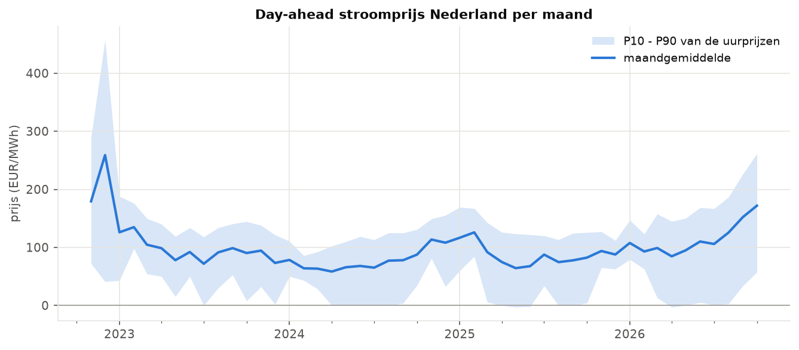
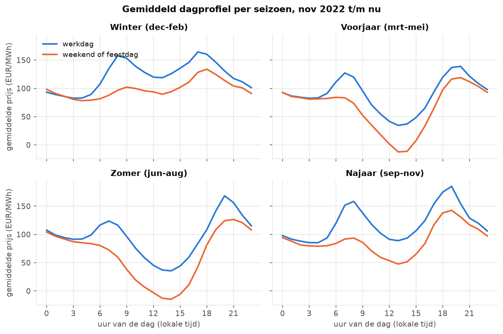
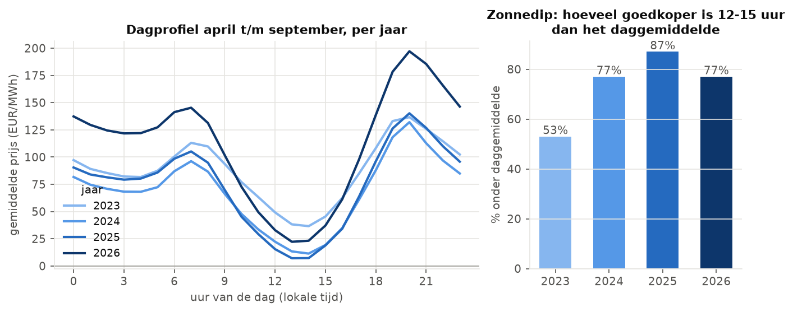
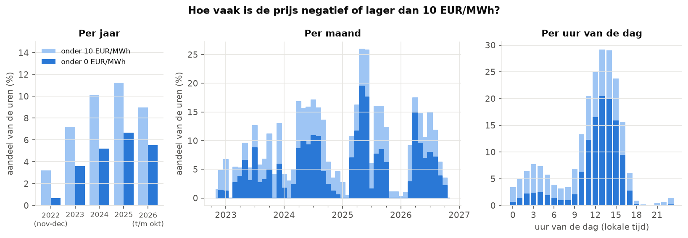
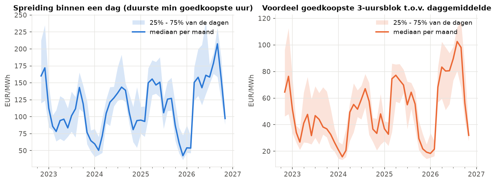
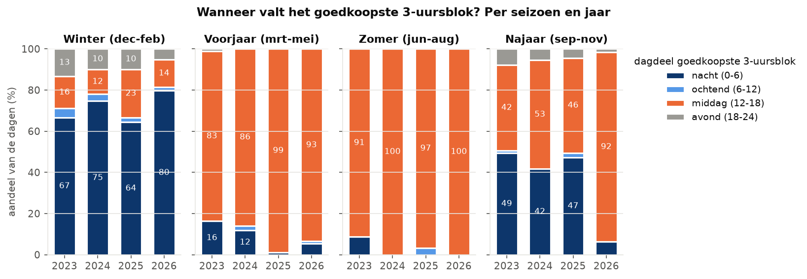
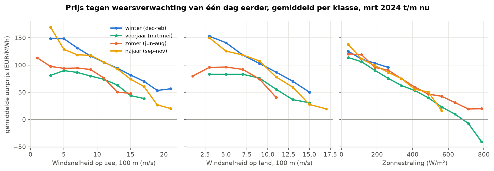
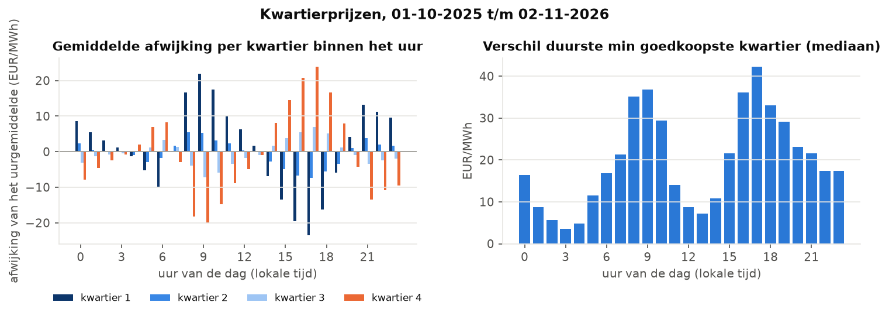
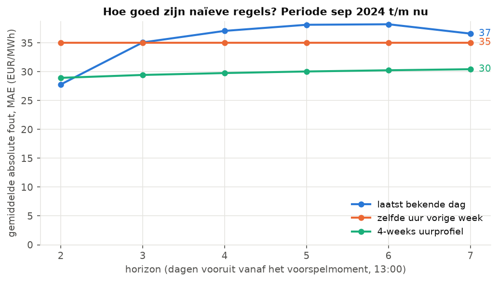

# Verkenning van de Nederlandse day-ahead stroomprijs

Datum: 1 november 2026. Data: EPEX day-ahead, biedzone NL, via Energy-Charts (CC BY 4.0), 1 november 2022 t/m 2 november 2026, uurgemiddelden (35.111 uren). Weer: Open-Meteo (CC BY 4.0), verwachting zoals die één dag eerder was, vanaf 1 maart 2024. Alle uren en dagen in dit rapport zijn in Nederlandse tijd. De zomertijdwissels (dagen met 23 of 25 uur) zijn meegenomen met hun werkelijke aantal uren.

Figuren en cijfers komen uit `scripts/verkenning.py`. De kerncijfers staan ook in `reports/verkenning/kerncijfers.json`.

## Samenvatting

De stroomprijs is sinds 2023 vooral een verhaal van de vorm van de dag: het verschil tussen het duurste en goedkoopste uur op een dag is doorgaans ruim 100 EUR/MWh, terwijl het maandgemiddelde meestal tussen 60 en 125 EUR/MWh ligt. Zon bepaalt het profiel van april tot september (middagdip, vaak negatief, vooral in het weekend), wind drukt de prijs vooral in het najaar en de winter. Een simpel gemiddeld uurprofiel van de laatste vier weken zit er gemiddeld 30 EUR/MWh naast; dat is het ijkpunt dat het model op dag 2 t/m 5 moet verslaan.

## 1. Prijsniveau per maand

Na de energiecrisis daalde het maandgemiddelde van 259 EUR/MWh (december 2022) naar 58 EUR/MWh (april 2024). Daarna liep het weer op: 2024 kwam uit op 77, 2025 op 87, en 2026 tot en met oktober op 116 EUR/MWh. Oktober 2026 was met 172 EUR/MWh de duurste maand sinds eind 2022. De band tussen P10 en P90 van de uurprijzen is breed: in de laatste twaalf maanden gemiddeld van 32 tot 164 EUR/MWh rond een gemiddelde van 110. De spreiding binnen een maand is dus even groot als het niveau zelf.

| Jaar | Gemiddelde (EUR/MWh) | Standaardafwijking |
|---|---|---|
| 2022 (nov-dec) | 220 | 129 |
| 2023 | 96 | 49 |
| 2024 | 77 | 50 |
| 2025 | 87 | 50 |
| 2026 (t/m okt) | 116 | 69 |

## 2. Dagprofiel per seizoen en dagtype

Een werkdag heeft twee pieken: 's ochtends rond 7-9 uur en 's avonds rond 17-20 uur. De avondpiek is het duurst, in het najaar gemiddeld 185 EUR/MWh om 19 uur. In de winter is de nacht (3-4 uur) het goedkoopst; in voorjaar en zomer is dat de middag (13-14 uur, gemiddeld 35 EUR/MWh op werkdagen). In het weekend en op feestdagen ligt de prijs lager en zakt de middag in voorjaar en zomer gemiddeld onder nul.

De zonnedip is de laatste jaren veel dieper geworden. In het zomerhalfjaar (april t/m september) lag de prijs tussen 12 en 15 uur in 2023 nog 53% onder het daggemiddelde; in 2024 was dat 77% en in 2025 87%. In 2026 is het 77%, maar in euro's is de dip het grootst ooit (86 EUR/MWh), omdat het hele prijsniveau en vooral de avondpiek omhoog gingen. De avond is in 2026 zo'n 60 EUR/MWh duurder dan in de jaren ervoor; de middag bleef goedkoop.

| Zomerhalfjaar | Daggemiddelde | Prijs 12-15 uur | Dip |
|---|---|---|---|
| 2023 | 88 | 41 | 47 (53%) |
| 2024 | 69 | 16 | 53 (77%) |
| 2025 | 74 | 10 | 65 (87%) |
| 2026 | 112 | 26 | 86 (77%) |

## 3. Negatieve en zeer lage prijzen

Negatieve prijzen komen steeds vaker voor: 316 uur in 2023, 458 in 2024, 584 in 2025 (6,7% van alle uren, op 114 verschillende dagen) en 406 uur in 2026 tot en met oktober. Ze zitten bijna allemaal op één plek: 78% van de negatieve uren valt tussen 11 en 17 uur, en de maanden april, mei en juni leveren de meeste. Tussen 13 en 15 uur is de prijs in één op de vijf uren negatief, over alle seizoenen en dagen heen. Weekend- en feestdagen zijn goed voor 62% van de negatieve uren, terwijl ze maar 31% van de dagen zijn. De laagste prijs was -500 EUR/MWh (2 juli 2023, 13 uur), de hoogste 873 EUR/MWh (12 december 2024, 17 uur).

## 4. Spreiding binnen een dag

Het verschil tussen het duurste en goedkoopste uur van een dag is doorgaans groot: de mediaan over alle dagen is 115 EUR/MWh, en op 60% van de dagen is het meer dan 100. Het goedkoopste aaneengesloten blok van drie uur ligt gemiddeld (mediaan) 48 EUR/MWh onder het daggemiddelde, oftewel ongeveer 4,8 cent per kWh zonder belastingen. Dat is de winst die een huishouden pakt door verbruik naar dat blok te verschuiven in plaats van gelijk over de dag. In 2026 is dat voordeel het grootst tot nu toe: 68 EUR/MWh (mediaan). In de winter is het voordeel kleiner (29 EUR/MWh, 26% van het daggemiddelde), in voorjaar en zomer het grootst (58 tot 62 EUR/MWh, ruim 80% van het daggemiddelde, omdat het blok vaak rond nul ligt).

| Jaar | Spreiding (mediaan) | Voordeel 3-uursblok (mediaan) | Als % van daggemiddelde |
|---|---|---|---|
| 2023 | 98 | 35 | 37% |
| 2024 | 107 | 41 | 54% |
| 2025 | 116 | 48 | 56% |
| 2026 (t/m okt) | 151 | 68 | 64% |

## 5. Wanneer valt het goedkoopste 3-uursblok?

In de zomer valt het goedkoopste blok vrijwel altijd in de middag (97 tot 100% van de dagen), en in het voorjaar in 83 tot 99% van de dagen. In de winter is het de nacht (64 tot 80%), met de middag als tweede. Het najaar is de twijfelmaand: in 2023 tot en met 2025 was het ongeveer half nacht, half middag. In 2026 (alleen september en oktober, november ontbreekt nog) viel het blok in 92% van de dagen in de middag. Ochtend en avond zijn vrijwel nooit het goedkoopst.

## 6. Samenhang met wind en zon

De prijs daalt vrijwel rechtlijnig met de windsnelheid en met de zonnestraling. Bij weinig wind op zee (onder 5 m/s) is de uurprijs gemiddeld 113 EUR/MWh, bij veel wind (boven 15 m/s) 54, en dan is 11% van de uren negatief. Overdag met veel zon (boven 500 W/m²) is de prijs gemiddeld 21 EUR/MWh; overdag zonder zon is dat 123. Wind telt vooral in winter en najaar (correlatie -0,5), zon vooral in voorjaar en zomer. Wind op zee en wind op land zeggen vrijwel hetzelfde; het gemiddelde van de zeepunten en van de landpunten lopen in de pas. Het seizoen verschuift wel het niveau van de hele lijn: dezelfde wind geeft in de zomer een lagere prijs dan in de winter.

| Seizoen | Wind op zee | Wind op land | Straling (alle uren) | Straling (9-17 uur) |
|---|---|---|---|---|
| Winter | -0,53 | -0,53 | 0,00 | -0,17 |
| Voorjaar | -0,22 | -0,17 | -0,58 | -0,53 |
| Zomer | -0,21 | -0,21 | -0,50 | -0,32 |
| Najaar | -0,43 | -0,43 | -0,25 | -0,39 |
| Alle | -0,27 | -0,26 | -0,45 | -0,57 |

Correlaties tussen uurprijs en de weersverwachting van één dag eerder, maart 2024 t/m nu. Wind op zee is het gemiddelde van de vijf zeepunten (inclusief Duitse Bocht), wind op land dat van de zeven landpunten voor wind (inclusief Noord-Duitsland). Straling is het gemiddelde over alle veertien punten.

## 7. Kwartierprijzen sinds oktober 2025

Sinds 1 oktober 2025 kent de markt een prijs per kwartier. Over 9.553 uren wijkt een kwartier gemiddeld 8 EUR/MWh af van het uurgemiddelde. Het verschil tussen het duurste en goedkoopste kwartier binnen een uur is doorgaans 16 EUR/MWh (mediaan), maar in 42% van de uren meer dan 20 en in 13% meer dan 50. Er is geen vast patroon zoals "eerste kwartier altijd duurder": over alle uren is het eerste kwartier gemiddeld maar 1 EUR/MWh duurder dan het laatste. Het patroon volgt de helling van de dag. In uren waarin de prijs stijgt (6-7 uur en 15-18 uur) is het eerste kwartier het goedkoopst en het laatste het duurst; om 17 uur scheelt dat gemiddeld 48 EUR/MWh. In uren waarin de prijs daalt (8-10 uur en 21-23 uur) is het andersom. 's Nachts (2-5 uur) verschillen de kwartieren nauwelijks (3 tot 6 EUR/MWh).

Voor een site die per uur toont betekent dit: voor de voorspelling van dag 2 t/m 5 is het uur ruim fijn genoeg, want de voorspelfout (zie 8) is veel groter dan het kwartierverschil. Voor "morgen", dat al bekend is, loont het om rond de ochtend- en avondhelling te laten zien dat het begin en het einde van het uur tientallen euro's verschillen, of om daar de kwartieren te tonen.

## 8. Hoe goed zijn naïeve regels?

Drie simpele regels, steeds met als voorspelmoment dag D om 13:00, als morgen (D+1) net bekend is. "Laatst bekende dag" herhaalt het uurprofiel van D+1. "Zelfde uur vorige week" pakt de prijs van precies een week voor het doeluur; die dag is voor elke horizon al bekend, dus de fout is voor alle horizonten gelijk. "4-weeks uurprofiel" neemt per uur het gemiddelde van de laatste 28 bekende dagen. Voor dag 2 is de laatst bekende dag het best (28 EUR/MWh), daarna is het 4-weeks profiel beter en blijft het rond 30 EUR/MWh tot dag 7. De fout van het profiel loopt dus nauwelijks op met de horizon. De gemiddelde prijs in deze periode was 99 EUR/MWh met een standaardafwijking van 61. Ter vergelijking: wie het daggemiddelde van de doeldag precies zou kennen, maar elk uur op dat gemiddelde zet, zit er nog 33 EUR/MWh naast. De vorm van de dag is dus net zo belangrijk als het niveau.

| Horizon (dagen) | Laatst bekende dag | Zelfde uur vorige week | 4-weeks uurprofiel |
|---|---|---|---|
| 2 | 27,8 | 35,1 | 29,0 |
| 3 | 35,1 | 35,1 | 29,5 |
| 4 | 37,1 | 35,1 | 29,8 |
| 5 | 38,2 | 35,1 | 30,1 |
| 6 | 38,2 | 35,1 | 30,3 |
| 7 | 36,6 | 35,1 | 30,4 |

MAE in EUR/MWh, periode september 2024 t/m nu (de periode die de officiële backtest ook dekt). Over 2023 t/m nu zijn de cijfers 1 tot 2 EUR/MWh lager. Dit is een eerste ijkpunt; de officiële backtest in fase 3 rekent dezelfde regels per dag door, met dezelfde herschattingen als het model.

## Wat dit betekent voor het model en de site

1. **Het niveau verschuift sterk** (maandgemiddelde van 58 tot 259 EUR/MWh, oktober 2026 weer 172). Het model moet leunen op het recente prijsniveau en op een rollend trainingsvenster. Een kalibratie van de intervallen op de laatste 30 dagen is nodig, en de backtest moet per periode rapporteren.
2. **Het 4-weeks uurprofiel is het ijkpunt**: ongeveer 30 EUR/MWh fout op elke horizon. Het model moet daar op dag 2 en 3 duidelijk onder komen; op dag 5 tot 7 kan de winst alleen uit de weersverwachting komen, want de naïeve fout loopt daar niet verder op.
3. **De vorm van de dag telt zo zwaar als het niveau** (33 EUR/MWh fout als je alleen het daggemiddelde weet). Uur, seizoen en dagtype horen als kenmerken in het model, en liefst in combinatie met zon en wind.
4. **Zon maakt de middag goedkoop en vaak negatief**, vooral april t/m september en in het weekend. Het P10-interval moet onder nul kunnen; het model mag negatieve prijzen niet wegmiddelen. Straling maal uur van de dag is het belangrijkste samenspel.
5. **Wind werkt rechtlijnig en vooral in najaar en winter.** Zee- en landpunten geven bijna dezelfde informatie; gemiddelden per groep zijn genoeg. Door de rechte lijnen heeft een lineair kwantielmodel een eerlijke kans naast LightGBM.
6. **Het goedkoopste 3-uursblok is in zomer en winter goed te voorspellen** (middag respectievelijk nacht). Het najaar is lastig: tot 2025 ongeveer half-half. De site kan in de zomer stellig zijn over "laad in de middag" en moet in het najaar de onzekerheid laten zien.
7. **Het voordeel van verschuiven is de kernboodschap van de site**: doorgaans 48 EUR/MWh (4,8 cent per kWh), in 2026 zelfs 68. Dat getal mag op de site, per dag en als jaargemiddelde.
8. **Uurweergave is goed genoeg voor de voorspelling, niet voor morgen.** De kwartieren verschillen in de ochtend- en avondhelling tot 40 à 50 EUR/MWh binnen één uur. Toon voor morgen de kwartieren, of in elk geval de helling. Zorg dat uurgemiddelden op de site op dezelfde manier uit kwartieren komen als in de data (gemiddelde van vier kwartieren).
